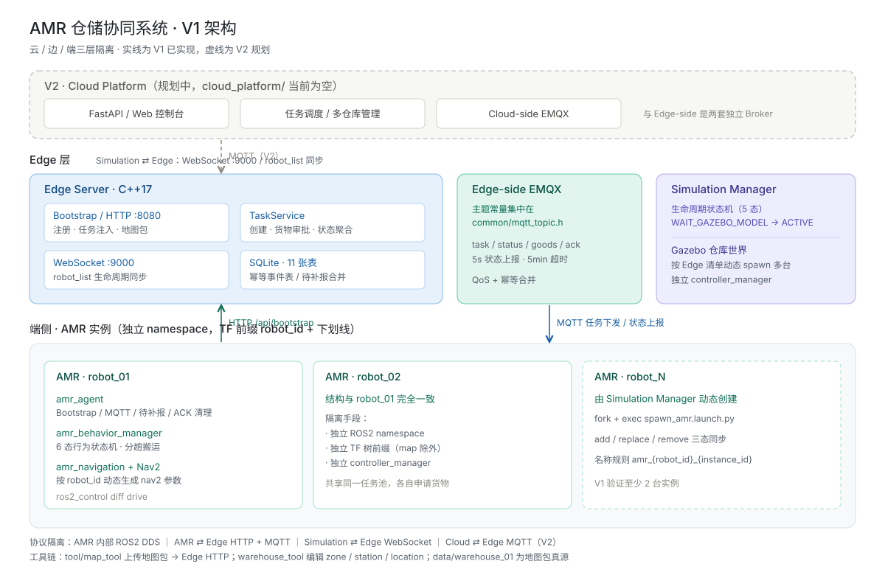
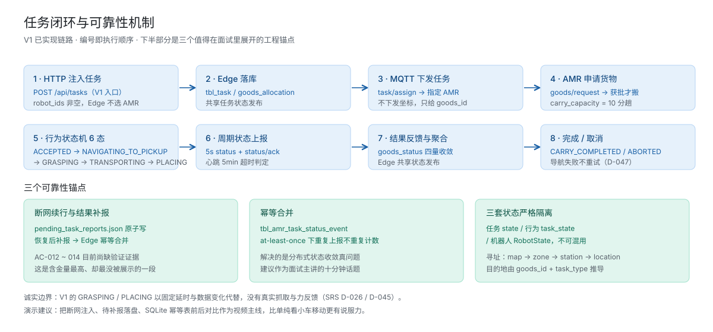

# AMR Warehouse Collaborative System

> **Multi-robot task orchestration & state synchronization for warehouse AMRs.**
> A ROS2 Humble + Gazebo simulation platform where an Edge Server dispatches transport tasks to multiple AMRs over MQTT, with idempotent state reporting and offline recovery.

基于 ROS2 Humble 的智能仓储多机器人**任务编排与状态同步**仿真平台。V1 已跑通「云端清单 → 仿真多机 → 任务下发 → 分趟搬运 → 状态回传」全链路。



    

---

## 30 秒看懂

**这个项目解决的不是 SLAM 或路径规划，而是「多台机器人如何被可靠地派活、如何把执行状态不丢不重地收回来」。**

- **Edge Server**（C++17）负责注册、地图包管理、任务注入与状态聚合，SQLite 落库 11 张表；
- **AMR 实例**由 `amr_agent` / `amr_behavior_manager` / `amr_navigation` 组成，通过 HTTP Bootstrap 拿到 MQTT 连接信息，之后走 MQTT 收发任务与状态；
- **Simulation Manager** 通过 WebSocket 从 Edge 拉机器人清单，在 Gazebo 里动态 spawn 多台 AMR，并管理「进程已启动 → 模型就绪 → 控制器就绪 → ACTIVE」的生命周期；
- **通信是隔离的**：AMR 内部 ROS2 DDS，AMR ↔ Edge 用 HTTP + MQTT，Simulation ↔ Edge 用 WebSocket，Cloud ↔ Edge 预留独立 EMQX（V2）。



## 三个值得展开的工程亮点

**1 · at-least-once 下的状态收敛。** MQTT 不保证恰好一次。AMR 的 5 秒周期上报配合 `status/ack` 清理，未确认的结果原子写入 `pending_task_reports.json`，断网恢复后补报；Edge 侧用 `tbl_amr_task_status_event` 幂等表合并，重复上报不会重复计数。配套 `goods_status` 四量不变式做结果校验。这是一条完整的分布式可靠性链路，而不是简单的「发个消息」。

**2 · 仿真生命周期状态机。** `WAITING_CREATE → LAUNCHING → WAIT_GAZEBO_MODEL → WAIT_CONTROLLER → ACTIVE`。它处理的是真实工程里的竞态：`ros2 launch` 返回成功 ≠ Gazebo 模型已出现 ≠ controller_manager 已就绪。控制器检查、add / replace / remove 三态同步都围绕这个状态机展开。

**3 · 多机 namespace 隔离。** 每台 AMR 有独立 ROS2 namespace、独立 TF 树前缀（`robot_id + "_"`，`map` 除外）、独立 controller_manager，Nav2 参数按 `robot_id` 动态生成。这是 ROS2 多机器人最容易踩的坑，V1 已验证至少两台实例互不干扰。

## Quick Start

```bash
# 0. 依赖：Ubuntu 22.04 / ROS2 Humble / Gazebo 11 / Nav2 / EMQX
#          Paho MQTT C++ / yaml-cpp / libwebsockets / libzip / SQLite / C++17

# 1. 凭据外置（MQTT 密码不写入仓库）
cp .env.example .env
#    编辑 .env，把 AMR_MQTT_PASSWORD 改成本地 EMQX 的密码

# 2. 构建（顺序与细节见 docs/development/build-run.md）
source /opt/ros/humble/setup.bash
(cd robot_ws && colcon build --merge-install --symlink-install)
(cd simulation_ws && colcon build --merge-install --symlink-install)
cmake -S edge_server -B edge_server/build && cmake --build edge_server/build -j2

# 3. 启动 Edge Server（脚本自动 source .env）
./edge_server/scripts/run_edge_server.sh

# 4. 启动 Gazebo 仓库世界 / Nav2 / Simulation Manager / AMR
#    四个终端的启动顺序与参数见 docs/development/build-run.md
```

配置文件 `edge_server/config/edge_server.yaml` 中的 `password: "${AMR_MQTT_PASSWORD}"` 只是占位符，由 `ConfigManager::load()` 启动时展开；未设置时服务会告警且 MQTT 连接失败。修改 YAML 后需重新 `cmake --build`（CMake 会把它拷进 `bin_dir/config/`），也可用 `--config <path>` 显式指定。

## 验证状态（诚实清单）

| 范围 | 状态 |
|---|---|
| 构建、Bootstrap、注册、地图包、导航初始化 | 已验收 AC-001 ~ 010 |
| 任务注入与下发、UNLOAD / LOAD 单趟与多趟、结果反馈、双机隔离 | 已验收 AC-015 ~ 018 |
| 任务取消 AC-011、断网续行与结果补报 AC-012 ~ 014 | **代码已实现，缺验证证据**，已列入整改 |
| 真实硬件 / 传感器 / 机械臂、交通协调、电量管理、Cloud Platform | V1 明确不包含 |

逐项记录见 [V1 验收清单](docs/development/v1-acceptance-checklist.md)。

## 设计取舍（面试高频追问）

| 决策 | 动机 | 代价 / 边界 |
|---|---|---|
| Edge 不自动选 AMR，`robot_ids` 必须非空 | 把调度策略留在上层，避免耦合进通信层 | V1 没有动态分配与优先级 |
| 任务不下发坐标 | 目的地由 `goods_id + task_type` 沿 `map → zone → station → location` 推导，任务与地图解耦 | 依赖站点数据一致性 |
| Cloud-side 与 Edge-side 两套独立 EMQX | 云端故障不影响车间实时链路 | 多一套 Broker 运维成本 |
| 共享任务池 + 每趟 `goods/request` 审批 | AMR 自主分趟（`carry_capacity=10`），Edge 状态耦合小，天然支持断网续行 | 单趟暂按单类货物 |
| 抓取 / 放置以数据变化 + 固定延时代替 | V1 聚焦通信与状态闭环，不引入机械臂复杂度 | **演示里没有真实物理交互** |

完整的 51 条已确认决策见 [SRS 1.5 节](docs/requirements/srs.md)，关键架构决策见 [ADR-0001](docs/architecture/adr/0001-edge-task-injection-and-mqtt-task-protocol.md)。

## 仓库结构

| 路径 | 内容 |
|---|---|
| `edge_server/` | C++ Edge Server：HTTP / MQTT / WebSocket / SQLite / TaskService |
| `robot_ws/` | AMR 软件栈：`amr_agent`、`amr_behavior_manager`、`amr_navigation`、`amr_description`、`amr_interfaces` |
| `simulation_ws/` | `warehouse_simulation`、`simulation_manager`（生命周期 + WS 同步） |
| `tool/` | `warehouse_tool`（zone / station / wall 编辑器）、`map_tool`（地图包打包上传） |
| `data/warehouse_01/` | 地图包真源：zones / stations / walls / metadata / pgm / world |
| `common/` | 跨端共享的 MQTT Topic 常量 |
| `docs/` | 需求、接口契约、架构文档、ADR、构建说明、验收清单 |

## 文档索引

- [需求基线 SRS V0.18](docs/requirements/srs.md) · [接口契约](docs/requirements/interface-contract.md)
- [系统架构](docs/architecture/system.md) · [任务状态机](docs/architecture/task-state-machine.md) · [Edge 数据模型](docs/architecture/edge-data-model.md)
- [构建与启动](docs/development/build-run.md) · [Nav2 调参笔记](docs/development/nav2-tuning-notes.md) · [故障排查](docs/development/troubleshooting-navigation.md)
- [V1 验收清单](docs/development/v1-acceptance-checklist.md) · [项目评审与改进清单](docs/development/project-review.md)

## 关于 V2

`cloud_platform/` 目前为空占位。后续方向按优先级为：交通管理（路口优先权与冲突消解）→ 只读 Web 看板 → Cloud Platform 通过 MQTT 发布任务（保留 V1 的 HTTP 注入接口）。需求详见 [SRS 第 8 章](docs/requirements/srs.md)，当前设计评审见 [project-review.md](docs/development/project-review.md)。
