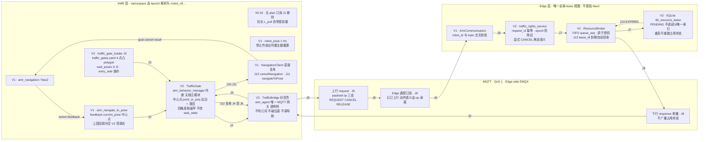
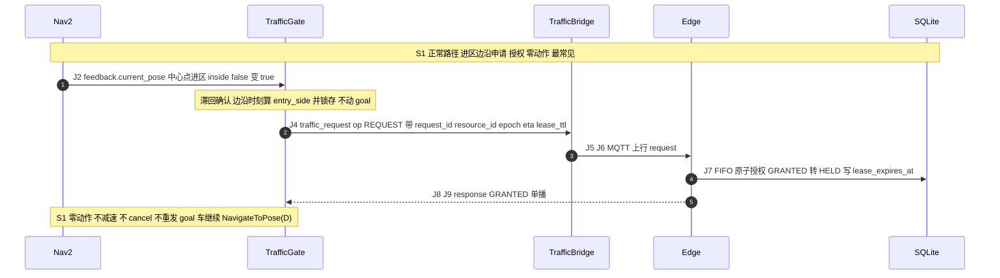
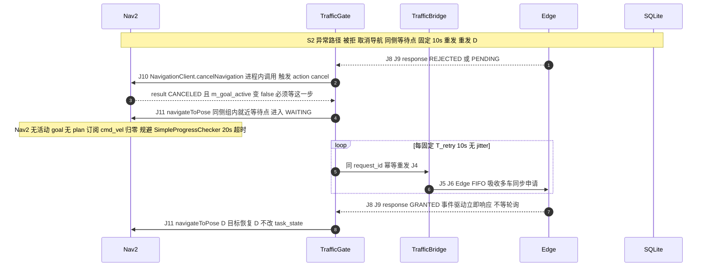
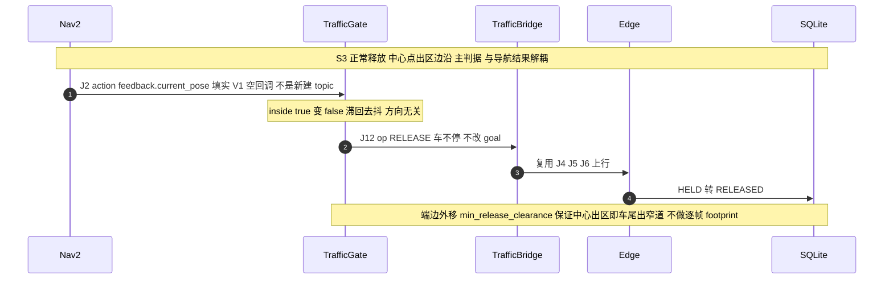
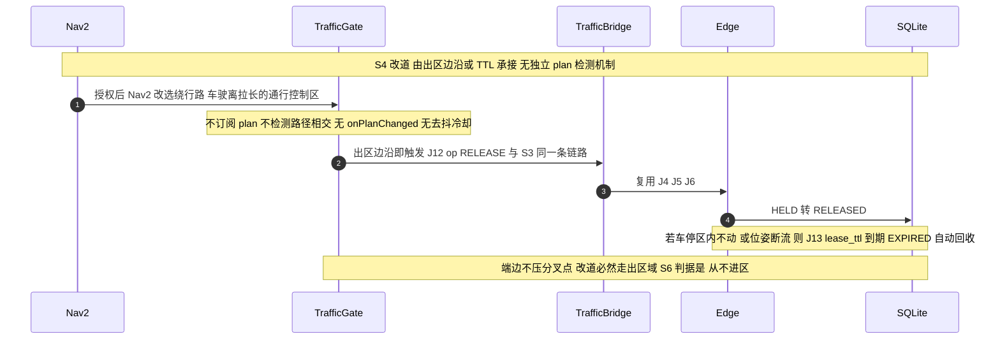
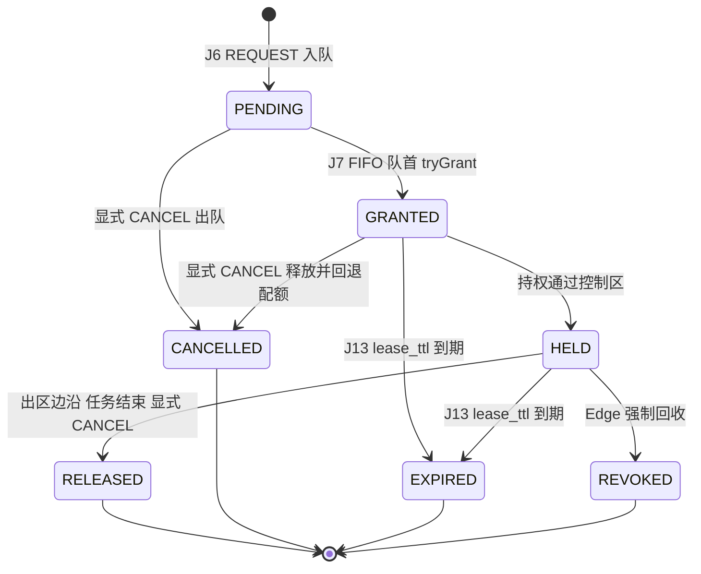

# V2 交通路权 · 图的可读文字版（mermaid）

> **状态：已定案图示的文字转写 / 不新增任何设计决策**，2026-11-22 V0.20 同步。
>
> **为什么有这份文件**：`../../assets/v2-traffic-dataflow.svg` 与 `../../assets/v2-traffic-sequence.svg` 是矢量图，写代码的 agent 读 `docs/` 时只能拿到文件名、读不到图内文字。本文件把两张图逐条转写为 **mermaid 纯文本**，供 agent / 纯文本工具 / 代码评审直接解析。
>
> **单一真值（重要）**：语义以 [`v2-traffic-control-chain.md` §4〈数据链路逐跳表〉与 §6〈五个时序场景〉](v2-traffic-control-chain.md) 为准；决策以 [`v2-resource-arbitration-and-bt.md`](v2-resource-arbitration-and-bt.md) 3.2 与 [`../version-roadmap.md`](../version-roadmap.md) INV-13 / INV-14 为准。本文件**只提供结构视图**，图中一律用 **J 编号** 指路，不复制逐跳表、不改写任何定案。图中出现与表格不一致时，**以控制链文档为准并回报冲突**。
>
> **三份等价物**：SVG（人看，保留不动）· 本文件 mermaid（agent 看）· 控制链文档的表格与编号步骤（语义真值）。
>
> **V0.20 定案口径**：独立 `traffic_gates.yaml` 的 4 点凸 `polygon` 通行控制区 + `wait_poses{l1,l2}`；AMR **中心点** `point_in_poly` 的 `inside` 进出边沿为主判据（滞回双阈值）；**全程不订阅 `plan`**；`L_pull` 拉长自带提前量；改道释放语义由出区边沿 + TTL 承接。权威口径见 `.workbuddy/artifacts/traffic-gate-8-decisions-frozen.md`。
>
> **渲染说明**：mermaid 代码块由 GitHub、VS Code（Markdown Preview Mermaid Support）、Typora 等直接渲染。若所用渲染器不支持 mermaid，本文件的「J 编号速查」「participant 对照」「S5 兜底表」「红线」「状态转移文字」仍是完整可读的纯文本；完整语义始终在控制链文档。

## 章节速查

| 章节 | 对应 SVG | mermaid 类型 | 回答什么 |
| --- | --- | --- | --- |
| §1 进程边界与数据链路 | `v2-traffic-dataflow.svg` | `flowchart LR` | 谁连谁、跨几个进程、J 编号怎么走 |
| §2 五场景时序 | `v2-traffic-sequence.svg` | `sequenceDiagram` × 4 | 每个场景的消息先后顺序 |
| §3 lease 状态机 | `v2-traffic-dataflow.svg` 右下 | `stateDiagram-v2` | Edge 侧占用状态的合法转移 |
| §4 对应关系与差异 | 两张 | — | 转写时补全 / 标注了什么 |

---

## 0. participant 对照（§2 通用）

| 图中别名 | 全名 | 所属侧 |
| --- | --- | --- |
| `N` | Nav2 / `amr_navigation`（含 `NavigationClient`） | AMR 进程 A |
| `G` | `TrafficGate` | `amr_behavior_manager` 进程 B，**内嵌、无独立模块** |
| `B` | `TrafficBridge` | `amr_agent` 进程 C，唯一 MQTT 网关 |
| `E` | `AmrCommunication` → `traffic_rights_service` → `ResourceBroker` | Edge |
| `S` | SQLite `tbl_resource_lease` | Edge |

> 五场景中 `task_state` **全程不变**（INV-13）；目标全程 `NavigateToPose(D)`，**等待点是唯一例外**，同侧组内就近选取且位于真实窄道上游（位置可区域内 / 区域外）。

---

## 1. 进程边界与数据链路（等价 `v2-traffic-dataflow.svg`）



**图中两个孤立节点是刻意不连线的**：`NOPLAN`（V0.20 定案移除 `plan` 订阅）、`RPOSE`（1 Hz `robot_pose` 禁止作主判据）。**无连线 = 不接入主链路**，不是漏画。

### 1.1 J 编号速查（精确接口名；完整语义见控制链 §4）

| J | 接口 / 名称 | 从 → 到 |
| --- | --- | --- |
| J1 | ~~ROS2 topic `plan`~~ → **无订阅**（V0.20 已移除） | — |
| J2 | `amr_navigate_to_pose` action feedback `current_pose`（AMR 中心点） | Nav2 → `NavigationClient` → `TrafficGate` |
| J3 | `traffic_gates.yaml` + `MapInfo.traffic_gates_yaml`（第 4 文件 / 下发 8 处链路） | 地图包 → `traffic_gate_loader` → `TrafficGate` |
| J4 | ROS2 `traffic_request`（`TrafficRequest.msg`） | `TrafficGate` → `TrafficBridge` |
| J5 | MQTT `amr/{robot_id}/traffic_rights/request`（QoS 1，payload `op`） | `TrafficBridge` → Broker |
| J6 | MQTT 通配 `amr/+/traffic_rights/request`（只订上行） | Broker → `AmrCommunication` |
| J7 | 进程内调用 / SQL：FIFO `queue_seq`、原子授权 | `traffic_rights_service` → `ResourceBroker` → SQLite |
| J8 | MQTT `amr/{robot_id}/traffic_rights/response`（**单播不广播**） | Edge → Broker |
| J9 | ROS2 `traffic_response`（`TrafficResponse.msg`） | `TrafficBridge` → `TrafficGate` |
| J10 | **`NavigationClient::cancelNavigation()`（进程内函数调用）** | `TrafficGate` → Nav2 |
| J11 | **`NavigationClient::navigateToPose(等待点 或 D)`（进程内函数调用）** | `TrafficGate` → Nav2 |
| J12 | `op=CANCEL` / `op=RELEASE`，复用 J4 → J5 → J6 → J7 | `TrafficGate` → Edge |
| J13 | `lease_expires_at` 到期 → `EXPIRED` 自动回收 | `ResourceBroker` 定时器 → SQLite |

> 所有 ROS2 名称一律**相对名**，由 launch namespace 解析为 `/{robot_id}/...`，**禁止写绝对名**（`../../requirements/interface-contract.md` 第 5 节）。

### 1.2 B 进程内控制链（关键：取消导航不需要任何跨进程接口）

```text
GRANTED 且处于 REQUESTING（S1）→ 零动作：不减速、不 cancel、不重发 goal，车继续 NavigateToPose(D)
REJECTED（S2）→ J10 cancelNavigation()
              → 等 result 回调把 m_goal_active 置为 false
              → J11 navigateToPose(同侧就近等待点) → WAITING
              → 固定 T_retry = 10 s 无 jitter、同 request_id 幂等重发
              → 仅 WAITING 收 GRANTED 立即 navigateToPose(D)
释放 → 出区边沿 / 任务结束 / lease_ttl 到期 / 显式 CANCEL，四触发取最早
     → 改道驶离由出区边沿承接，停住或位姿断流由 TTL 承接
```

### 1.3 三条红线（做错即返工，转写自控制链 §0）

1. **`amr_agent` 不碰位姿、不判几何、不做业务决策** —— 它是唯一 MQTT 网关，只把 `traffic_request` 原样发成 MQTT、把 MQTT 响应原样转成 `traffic_response`。
2. **`amr_behavior_manager` 不直连 MQTT** —— 不新增第二个 MQTT client，否则出现两个心跳源、两套断网待补报。
3. **Edge 不知道 Nav2 存在** —— 只认 `resource_id` / `request_id` / `epoch` / `lease_ttl`，不下发坐标、不下发途经点、不感知导航目标（INV-13）。

> **「怎么知道 AMR 取消了」的答案**：快路径 = 显式 `CANCEL`（`PENDING` 出队 / 已授权则释放 lease + 配额回退）；安全网 = J13 TTL 到期自动回收。Edge 不必可靠「知道」也能不占死。

---

## 2. 五场景时序（等价 `v2-traffic-sequence.svg`）

> 场景编号对应控制链 §6（S1~S5）。时间自上而下。`autonumber` 的序号与 SVG 的 ①②③… 一一对应。

### 2.1 S1 正常路径：进区边沿申请 → 授权 → 零动作（最常见）



**第一优先级契约**：`REQUESTING` 收 `GRANTED` **零动作**（AC-020 零 goal 重发、零停顿）。只有 `WAITING` 获批才重发 D。拉长 `L_pull` 保证申请早于车到真实窄道口，MQTT RTT 藏进「进区 → 到窄道口」的行驶时间。

### 2.2 S2 异常路径：被拒 → 取消导航 → 同侧等待点 → 固定 10 s 重发 → 重发 D



**易错点**：① `cancelNavigation()` 是异步的，**必须等 result 回调把 `m_goal_active=false`** 再发等待点，立即重发会被直接丢弃（`navigation_client.cpp:28-32`）；② 等待点按 `entry_side` **先筛组再组内 `argmin dist`**，不能全场 `argmin`（会选到对侧、无权限却要穿过整条窄道）；③ 去等待点会再次穿越边界，此时未持权，**不能误触发释放**；④ 等待点位置可区域内 / 区域外，但必须位于真实窄道**上游**。

### 2.3 S3 正常释放：中心点出区边沿（主判据，与导航结果解耦）



> **转写补全**：SVG 场景 6.3 第 ③ 跳从 `TrafficBridge` 直接画到 SQLite，是跨泳道的简化画法；**实际必须经 Edge**（`op=RELEASE` 走 J4→J5→J6→J7）。本文按控制链 §4 逐跳表补全，agent 勿照 SVG 那条直连线实现。方向无关 → 掉头从入口退出同样由该边沿覆盖。

### 2.4 S4 改道：语义保留、机制移除



### 2.5 S5 兜底：四触发取最早（用表格，不画时序）

S5 的四类触发**彼此并行、无严格先后**，画成时序图会引入虚假的顺序语义，故保持表格形式（等价控制链 §6.5 与 SVG 场景 6.5）。

| 触发 | 链路 | 说明 |
| --- | --- | --- |
| 导航 `SUCCEEDED` / 任务结束 / 异常 `ABORTED` | `TrafficGate` → J12 release | 中心点出区边沿漏检时的兜底；**已降级为兜底，不是主判据** |
| `lease_expires_at` 到期 | Edge 定时器 → `EXPIRED` → 自动回收（J13） | AMR 崩溃 / `cancel` 丢包 / 断网 / 车停区内不动 / 位姿断流的最终兜底 |
| AMR 显式 `CANCEL` | J12 → J6/J7 | `PENDING` 出队；`GRANTED` / `HELD` 释放 lease + 配额回退 |
| QoS 1 重传 | `request_id` 幂等吸收 | 带旧 `epoch` 的迟到消息一律丢弃并记录 |

> 等待期间 Nav2 无活动 goal → **结构上**规避 `SimpleProgressChecker` 的 `movement_time_allowance = 20 s`，不靠调参。

---

## 3. Edge lease 状态机（等价 `v2-traffic-dataflow.svg` 右下角）



纯文字等价：`PENDING → GRANTED → HELD → RELEASED`；异常 `CANCELLED` / `EXPIRED` / `REVOKED`。**`PENDING` 不进 `(resource_type, resource_id)` 部分唯一索引**，因此多车可同时排队；唯一索引只覆盖 `GRANTED` / `HELD`。

---

## 4. 与 SVG / 文档的对应关系（转写时的补全与标注）

| SVG 元素 | 本文位置 | 转写处理 |
| --- | --- | --- |
| 数据流图三个进程框 + MQTT 带 + Edge 框 | §1 `flowchart` | `subgraph` 表达进程边界；每条连线只标 J 编号，精确接口在 §1.1 |
| 「无 `plan` 订阅」「`robot_pose` 禁用」 | §1 两个孤立节点 | **刻意不连线**，并注明「无连线 = 不接入主链路」 |
| 底部控制链文字块 | §1.2 `text` 代码块 | 保持纯文本，未改成图形（顺序语义更清楚） |
| 三条红线 | §1.3 | 逐条转写 |
| 时序图场景 6.1 / 6.2 / 6.3 / 6.4 | §2.1 ~ §2.4 `sequenceDiagram` | 每条消息标注 J 编号；`autonumber` 对应 SVG 的 ①②③ |
| 时序图场景 6.5 | §2.5 表格 | **不画时序图**：四触发并行，避免引入虚假顺序 |
| 时序图场景 6.3 第 ③ 跳（`TrafficBridge` → SQLite 直连） | §2.3 转写补全说明 | **补全经 Edge 的 J4→J5→J6→J7 链路**，SVG 为简化画法，勿照抄 |
| 数据流图右下 lease 状态机 | §3 `stateDiagram-v2` | 补全 `CANCELLED` / `EXPIRED` / `REVOKED` 的合法来源与终止 |
| 「怎么知道 AMR 取消了」说明块 | §1.3 末尾引用 | 保留，指向控制链 §0 |

**未改动**：两张 SVG 文件本身、控制链文档的逐跳表与场景步骤、任何源码 / `.msg` / 地图数据。本文件只是**新增一份可读视图**。

---

## 5. 文档关系

| 文档 | 角色 |
| --- | --- |
| [`v2-traffic-control-chain.md`](v2-traffic-control-chain.md) §4 / §6 | **语义真值**：逐跳表、五场景步骤、取消导航调用链、检查项 |
| [`v2-implementation-spec.md`](v2-implementation-spec.md) | **实现级权威**：命名 / 消息字段 / 状态机 / 伪代码 / 全场景 / 自检 |
| [`v2-resource-arbitration-and-bt.md`](v2-resource-arbitration-and-bt.md) 3.2 | **决策权威**（INV-13 / INV-14） |
| [`../../assets/v2-traffic-dataflow.svg`](../../assets/v2-traffic-dataflow.svg) / [`v2-traffic-sequence.svg`](../../assets/v2-traffic-sequence.svg) | 人类阅读版图示，与本文件 mermaid **等价** |
| [`../../requirements/srs.md`](../../requirements/srs.md) V0.20 第 4.10 / 4.11 节 | V2 功能需求基线 |
| [`../../requirements/interface-contract.md`](../../requirements/interface-contract.md) §8 | V2 路权 MQTT / ROS2 接口契约、`traffic_gates.yaml` 数据结构 |
